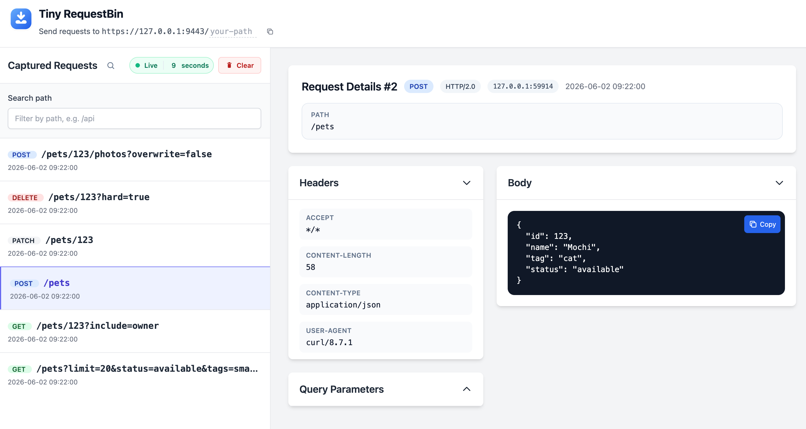
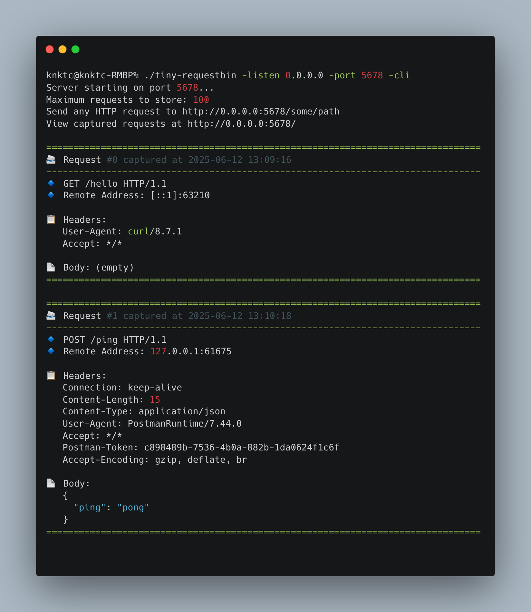

# Tiny RequestBin

*[English](README.md) | [简体中文](README_ZH_CN.md)*

Tiny RequestBin 是一个用 Go 语言编写的轻量级 HTTP 请求检查和调试工具。它可以捕获并显示 HTTP 请求，便于检查和调试。

本项目使用 Gemini 做了开局，后面使用 GitHub Copilot 进行修改，现在则主要由 Codex 维护。

[](https://golang.org/)
[](LICENSE)

## 特性

- 🚀 **轻量且快速**：简单实现，最小依赖
- 🔍 **请求检查**：查看传入的 HTTP 请求的详细信息
- 🌐 **Web 界面**：干净的界面浏览捕获的请求
- 📋 **CLI 模式**：可选择直接在终端打印请求
- 🔒 **本地运行**：所有数据都保留在您的机器上，无需外部服务

## 安装

### 方式一：使用 `go install` 安装

```bash
go install github.com/knktc/tiny-requestbin@latest
```

### 方式二：从 Releases 下载预编译二进制文件

在 [Releases](https://github.com/knktc/tiny-requestbin/releases) 页面中可以下载 macOS、Linux 和 Windows 的预编译二进制文件。

下载对应平台的压缩包后，解压并直接运行即可。

如果是在 macOS 上首次运行下载的二进制文件，Gatekeeper 可能会拦截。可以先执行下面两步：添加执行权限，并移除下载文件的隔离标记：

```bash
chmod +x tiny-requestbin
xattr -d com.apple.quarantine tiny-requestbin
```

然后再正常运行：

```bash
./tiny-requestbin
```

如果 macOS 仍然拦截，也可以在 `系统设置 > 隐私与安全性` 中手动允许。

特别说明：我没有 Windows 电脑，所以暂时还没有验证 Windows 二进制文件是否可用。欢迎大家测试后反馈意见。

### 方式三：使用 Docker

```bash
# 拉取并运行最新镜像
docker run -p 8282:8282 knktc/tiny-requestbin

# 或者使用自定义选项运行
docker run -p 8282:8282 knktc/tiny-requestbin -port 8282 -listen 0.0.0.0

# 使用 docker-compose
docker-compose up -d
```

### 方式四：使用 Helm 安装（Kubernetes）

```bash
# 使用默认配置安装
helm install my-requestbin helm/tiny-requestbin/

# 使用自定义选项安装
helm install my-requestbin helm/tiny-requestbin/ \
  --set config.max=1000 \
  --set service.type=NodePort

# 启用 HTTPRoute（Gateway API）
helm install my-requestbin helm/tiny-requestbin/ \
  --set httpRoute.enabled=true \
  --set 'httpRoute.parentRefs[0].name=my-gateway' \
  --set 'httpRoute.hostnames[0]=requestbin.example.com'
```

默认使用镜像 `knktc/tiny-requestbin:latest`，通过 `ClusterIP` 类型的 Service 暴露 `8282` 端口，资源限制为 `128Mi` 内存 / `500m` CPU。

### 方式五：从源码构建

```bash
git clone https://github.com/knktc/tiny-requestbin.git
cd tiny-requestbin
go build
```

## 使用方法

使用默认选项启动服务器：

```bash
tiny-requestbin
```

### 命令行选项

- `-port`：服务器监听的端口（默认：8282）
- `-listen`：服务器监听的地址（默认：127.0.0.1）
- `-max`：最大存储的请求数量（默认：100）
- `-cli`：启用 CLI 模式，在终端打印请求（默认：false）
- `-tls-cert`：TLS 证书文件路径（需与 `-tls-key` 一起使用以启用 HTTPS）
- `-tls-key`：TLS 私钥文件路径（需与 `-tls-cert` 一起使用以启用 HTTPS）

自定义选项示例：

```bash
tiny-requestbin -port 9000 -listen 0.0.0.0 -max 1000 -cli
```

使用 HTTPS 启动：

```bash
tiny-requestbin -port 9443 -listen 127.0.0.1 \
  -tls-cert ./certs/localhost.pem \
  -tls-key ./certs/localhost-key.pem
```

## 工作原理

1. 使用上述方法之一启动服务器
2. 向 `http[s]://[监听地址]:[端口]/任意/路径` 发送 HTTP 或 HTTPS 请求
3. 在浏览器中访问 `http[s]://[监听地址]:[端口]/` 查看捕获的请求
4. 如果启用了 CLI 模式，请求也会打印到终端

## Docker 多架构支持

Docker 镜像支持多种架构：
- `linux/amd64`（Intel/AMD 64位）
- `linux/arm64`（ARM 64位，Apple Silicon 等）

多架构镜像会在推送 tag 时通过 GitHub Actions 自动构建和发布。

## 截图

### Web 界面

Web 界面提供了一个简洁直观的方式来浏览和检查捕获的请求：



### CLI 模式

当使用 `-cli` 参数运行时，HTTP 请求会以美观的格式直接显示在终端中：



## 贡献

欢迎贡献！请随时提交 Pull Request。

## 许可证

该项目采用 MIT 许可证 - 详情请参见 [LICENSE](LICENSE) 文件。
